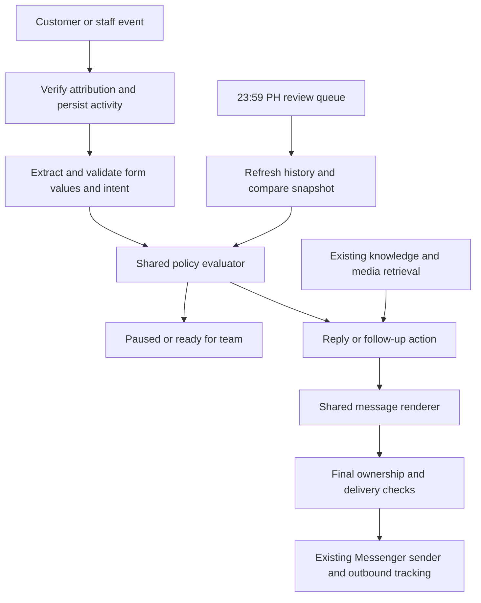

# Free concept/script, four-field intake, and reviewed reopening

Status: implemented and deployed on 2026-10-17. The architectural plan below is retained as the implementation contract. See [release verification](../chatbot-concept-script-release-2026-10-17.md) for the delivered behavior, tests, migration/activation order, and recovery details.

## Requested customer behavior

- Offer a free video concept or a free script. Never offer a free personalized video sample or imply that producing the commercial video is free.
- Prioritize these four required details, in this order, with a 100% completion target:
  1. Business Name
  2. Business Location
  3. Goal ng video
  4. Contact Number
- Prefer sending the complete form in one Messenger message. Support collecting the missing fields one at a time when that fits the conversation or the customer prefers it.
- Answer relevant customer questions, then return to missing required fields. Other discovery questions are optional and must not delay the form.
- Keep scheduled follow-ups, conversation personalization, and knowledge retrieval. Do not disable follow-ups or remove the knowledge library as part of changing the offer.
- Pause automatic replies and queued chatbot follow-ups when staff intervenes. Cancel stale queued work, then create eligible replacement work after a reviewed reopening.
- Review eligible paused conversations daily at 11:59 PM Philippine time (`23:59`, `Asia/Manila`). Reopen when EITHER the form is incomplete OR the customer has not clearly requested a commercial video, free concept, or free script, subject to durable stop rules.

Example initial intake message, sent as one intact message:

```text
Pwede po kayong mag-request ng free concept o free script. Pakisagutan po:
1. Business Name:
2. Business Location:
3. Goal ng video:
4. Contact Number:
```

The wording can match the customer's language. Keep the four labels, order, and line breaks. Do not repeatedly resend the entire blank form after receiving partial answers.

## Confirmed decision rule

The user confirmed 11:59 PM Philippine time and EITHER condition. There are no remaining timing or AND/OR questions.

```text
needs_continuation = missing_required_fields.length > 0 OR clear_request == false
may_reopen = due_for_review AND needs_continuation AND NOT durable_stop
             AND history_verified AND reviewed_snapshot_still_current
```

| Form | Customer clearly requested commercial/concept/script | Nightly outcome, if otherwise eligible |
| --- | --- | --- |
| Incomplete | No | Reopen; prioritize missing form details and address the unresolved inquiry |
| Incomplete | Yes | Reopen; collect only the missing details without asking them to agree again |
| Complete | No | Reopen; continue the conversation and clarify their desired next step without re-asking the form |
| Complete | Yes | Keep with the team; no automatic sales continuation |

These four rows also guide normal chatbot follow-ups while the bot owns the conversation. Follow-ups remain available whenever continuation is needed. A human takeover temporarily pauses them until the nightly review.

An explicit opt-out, refusal, order/conversion, staff disqualification, explicit staff hold, or disabled bot takes precedence over this table. A normal staff reply is a temporary takeover, not a permanent hold. A staff-confirmed qualified handoff is distinguished from automatic form-only qualification; it is not inferred merely from four filled fields.

Unknown is not an agreement. With successfully verified conversation history, absence of a clear request satisfies the second condition. A failed or incomplete history audit is a technical uncertainty and defers the review rather than pretending the customer is undecided.

## Findings from the existing code

- The production-oriented application is under `tokko-chatbot/`. Its release documents describe six commercial-video Pages sharing a knowledge source. Read the current configuration before deciding the exact Page scope; the documentation is historical evidence, not a live settings audit.
- `src/lib/chatbot.ts` builds replies and scheduled follow-ups separately. Both must receive the offer and intake policy.
- `formatChatbotReplyMessages` can split text near 110 characters and limits the combined reply to 320 characters. Asking the model for a single form bubble alone does not guarantee delivery as one intact message.
- Generic instructions currently ask at most one question at a time; follow-up style rules discourage labels ending in colons. Both need an explicit structured-form exception.
- Collection currently depends on configurable field labels and a percentage, with contact-specific continuation targets. Old targets must not cause premature completion of the new four-field form.
- The existing continuation review only considers bot-completed, chatbot-owned qualified contacts. Human-owned contacts are explicitly excluded by both TypeScript and SQL.
- The current review time only stores an integer hour. SQL can move the review earlier to approach an inbound-message window limit, so it does not implement a strict 23:59 schedule.
- Delivery checks inspect staff activity using the intake start time. A legitimate reopening needs its own auditable boundary; otherwise the original human reply will immediately stop the bot again.
- The cron route claims two reviews per invocation and runs reviews after follow-ups. Capacity and ordering must be reviewed if many chats become due together.
- The working tree already contains uncommitted continuation, webhook, control, dashboard, and follow-up changes. Preserve and extend those changes; use a new migration rather than rewriting a potentially applied migration.

## Implementation sequence

### 1. Establish the Page policy and preserve existing data

- Inspect current enabled commercial-video Pages, their instructions, follow-up prompts, fallback/welcome text, shared knowledge, and stored offer copy.
- Back up the affected Page configurations and any state/job rows that will be updated. Scope changes to the relevant business Pages rather than making every chatbot a video-agency bot.
- Replace conflicting free personalized sample offers in authoritative Page settings and relevant knowledge documents. Reindex edited knowledge so stale chunks cannot reintroduce the old offer. Audit relevant stored follow-up copy and templates too.
- Distinguish existing portfolio examples from a new personalized video sample. Existing portfolio work can answer a customer asking to see previous work, without promising free personalized production.
- Apply the four required fields at 100%. Preserve existing answers through an explicit alias mapping, such as business/company name, business address/location, video objective/goal, and phone/contact number. Do not infer a business name from a Messenger person's name or a product brand.
- Reconcile missing fields and obsolete per-contact detail targets for in-scope active/reviewable chats. Do not reset all contacts or revive historical terminal conversations.

### 2. Make the form a reliable delivery unit

- Add an explicit structured intake action to the generated response contract, such as `send_form`, `ask_missing_field`, or `none`, validated against the Page policy and saved details.
- Construct the canonical form in application code. Route it through a shared formatter that preserves all four lines in one message and bypasses ordinary sentence splitting/truncation for this bounded form.
- Apply the same behavior to replies, scheduled follow-ups, resumed conversations, fallback handling where relevant, and dashboard previews.
- Preserve customer-provided answers from all available history and subsequent corrections. Ask only about missing fields; a single answer may populate several fields.
- Validate field values conservatively: blank/unknown placeholders do not count, and a contact number must resemble a usable phone number without forcing one country's format on every customer.
- Do not add optional discovery fields to the required completion count. Finish required collection before optional questions.

### 3. Separate form completion, request intent, and staff ownership

- Track form completion separately from customer intent: commercial video, free concept, free script, undecided, declined, and unknown.
- Save customer evidence for a clear request. A customer asking about price, saying thank you, or going silent does not establish agreement. Accepting a free concept/script does not imply agreeing to buy a commercial.
- A complete form ends required collection but does not end follow-ups by itself. A clear request also does not end collection while required details are missing. Only a complete form AND a clear request make the normal intake ready for the team. Do not promise that a concept, script, or commercial has already been produced.
- Record temporary human takeover separately from explicit staff disable/hold and terminal outcomes. Do not make every existing `manual` stop eligible for automatic reopening.
- Immediately cancel pending/processing/manual-ready chatbot follow-ups on takeover. Retain checks before each outbound message/card so intervention during generation or between messages stops subsequent sends.

### 4. Add reviewed reopening without overriding later staff actions

- Extend configuration, API validation, dashboard controls, review records, and SQL with the confirmed 23:59 Asia/Manila schedule and OR condition.
- Store hour and minute and calculate the next 23:59 Asia/Manila occurrence explicitly. Do not reuse the current early-window-clamping formula or implement an elapsed takeover delay.
- At review time, refresh the conversation and extract any details or intent supplied during the human exchange. Evaluate the confirmed OR rule using the latest data.
- Preserve terminal stages, orders, opt-outs, refusals, explicit holds, disabled Pages, and trial restrictions. Unavailable or unauditable history does not authorize reopening. Verified history without a clear request satisfies the OR rule, including undecided or ambiguous customer intent.
- Resume atomically only if state, ownership, staff activity, customer inbound anchor, and policy configuration still match the reviewed snapshot. A later staff message or hold cancels the stale decision.
- Save a separate automation-resumed timestamp for staff-activity checks while preserving the original intake and handoff history. Do not extend messaging permission or the original intake lifetime to make a send possible.
- Queue at most one continuation per eligible review. Continue from saved answers and the customer's latest unresolved topic, prioritizing the missing form fields.
- An expired outbound window means no automatic send. Where otherwise eligible, wait for a new inbound message under the existing delivery rules.
- Review queue throughput and worker ordering so a shared due time does not create duplicate sends or a large avoidable backlog. Schedule eligibility at 11:59; report worker delay separately from the due time.

### 5. Verify and release

- Add focused regression coverage for single-message forms with splitting enabled, form line preservation, partial and multi-field answers, corrections, alias migration, phone values, and 4/4 completion.
- Cover free concept/script requests, price-only inquiries, ambiguous acknowledgments, requests for personalized samples, and stale knowledge offers in replies and follow-ups.
- Test takeover before generation, during generation, and between outbound messages; verify cancellation of queued work.
- Test the confirmed eligibility truth table, scheduling boundaries, repeated cron calls, concurrent workers, newer customer replies, newer staff activity, explicit holds, refusals, terminal outcomes, disabled settings, unreadable history, and expired send windows.
- Exercise the new SQL migration and atomic resume conditions in an isolated database before applying it to production.
- Run the relevant test suites, TypeScript, lint for changed files, and the production build. Record results rather than assuming the previous release's tests cover this change.
- Preview reply, follow-up, form, and reopening behavior for every affected Page without messaging customers.
- Release with configuration/state backups and an explicit rollback path. Read back the four fields, 100% target, offer wording, and schedule settings, then observe organic activity for incorrect offers, split forms, and unauthorized restarts.

## Completion criteria

The change is complete when all affected Pages offer only the authorized free concept/script, retain knowledge and follow-ups, collect the four required fields without splitting the full form, preserve known answers, pause on human intervention, and reopen eligible conversations at 23:59 Asia/Manila under the OR rule. Code checks, migration checks, and per-Page previews must pass before the release is considered verified.

## Architecture and implementation contracts

### A. One policy decision used by every chatbot path

Add a small `src/lib/chatbot-policy.ts` module with a pure evaluator and the commercial-video Page policy. Keep transport, database access, and model calls out of the evaluator.

Its input is a verified snapshot of Page policy, canonical form values, customer intent, current automation stop/ownership, pipeline provenance, and inbound/staff activity timestamps. Its result contains:

```ts
type ChatbotPolicyDecision = {
  missingRequiredFields: RequiredFieldKey[];
  formComplete: boolean;
  clearRequest: boolean;
  needsContinuation: boolean;
  nextAction: 'send_form' | 'ask_missing_field' | 'clarify_next_step' | 'handoff' | 'none';
  canReply: boolean;
  canScheduleFollowUps: boolean;
  canReviewReopen: boolean;
  reason: string;
};
```

The model extracts candidate facts and drafts conversation text. The application validates those facts, evaluates the OR rule, chooses permitted actions, and controls delivery. A model response cannot authorize a restart or mark a placeholder as a completed field.

Use the evaluator in inbound webhook handling, follow-up scheduling, follow-up generation, nightly review, delivery rechecks, and dashboard previews. Do not copy slightly different conditions into each path. Existing generic Page behavior remains available when this policy is not enabled for that Page.



### B. Form schema and response rendering

Create `src/lib/chatbot-intake.ts` for the versioned form schema, explicit aliases, field validation, missing-field calculation, and canonical form rendering.

| Canonical key | Customer-facing label | Validation |
| --- | --- | --- |
| `business_name` | Business Name | Explicit customer-supplied business identity; no profile-name or brand inference |
| `business_location` | Business Location | A usable business location; do not require a full street address unnecessarily |
| `video_goal` | Goal ng video | An identifiable video objective from the customer's answer |
| `contact_number` | Contact Number | Normalize spacing/separators; reject blanks, placeholders, and clearly malformed numbers |

Keep canonical keys independent of display labels. Adapt to the existing `collected_details` contract in one place, with a form-version marker. Store optional answers separately so they cannot inflate 4/4 completion. Alias migration uses an explicit mapping, preserves ambiguous legacy data for review, and never invents equivalence with fuzzy matching.

Use a shared `src/lib/chatbot-message-renderer.ts` boundary for replies and follow-ups. Its intake action produces a bounded, application-rendered form with line breaks in one message. Form output is validated as one complete unit, rather than fed through sentence splitting or sliced to a character cap that could remove Contact Number. Keep ordinary reply length limits for ordinary conversation.

Render all four fields only when introducing the form or when the customer requests the full form again. After partial answers, ask the next missing field, or send one compact remaining-fields message when helpful. Preserve all valid prior answers. Answer a relevant immediate inquiry before returning to collection; never stack optional discovery questions on top of the form.

Persist the successful form message ID/timestamp from outbound tracking. A generated-but-unsent form does not count as introduced, and a webhook retry must not resend a form that was already accepted by Messenger. Reuse the existing inbound reply claim and outbound-event records for idempotency.

### C. Persist facts and ownership separately

Reuse `chatbot_contact_states` and `chatbot_continuation_reviews`; avoid a parallel state store or a second scheduler. Extend state with bounded metadata needed for deterministic decisions:

- `form_version` and a policy revision reference.
- Request intent: `request_type` (`commercial_video`, `free_concept`, `free_script`, or null), `request_status` (`requested`, `undecided`, `declined`, or `unknown`), evidence message ID/quote, and the observation timestamp/history boundary.
- Temporary ownership: `pause_kind` (`human_takeover`, `ready_for_team`, `explicit_hold`, or null), `handoff_version`, and `last_human_activity_at`.
- `automation_resumed_at` and an incrementing `automation_epoch` for invalidating old jobs.

Use actual staff event timestamps with stable event/message IDs for idempotency and ordering; repeated history scans must not create a new handoff version for the same activity. Update `last_human_activity_at` monotonically so a delayed older echo cannot replace a newer takeover.

Retain existing `status`/`stop_reason` as the operational stopped/active gate. The metadata explains why a stop exists and whether the nightly worker may review it. Enforce valid combinations in transition functions and database constraints; do not introduce an independently editable active flag that can disagree with the existing gate.

All state transitions use one service, proposed as `src/lib/chatbot-state-transitions.ts`, backed by transactional database functions where state and jobs must change together. Existing handoff helpers delegate to it. Customer facts can be updated while stopped without enabling a reply.

| Trigger | State effect | Follow-up effect |
| --- | --- | --- |
| Customer sends details while bot owns chat | Merge facts and evaluate current policy | Replace stale sequence using the real inbound anchor |
| Staff replies or takes over | Stop; record temporary takeover and increment epoch/version | Cancel pending/processing/manual-ready chatbot jobs |
| Staff explicitly holds/disables or sets a durable outcome | Stop with durable reason | Cancel chatbot jobs; exclude from auto-reopen |
| Four fields complete, no clear request | End form collection; bot can continue normally | Continue relevant follow-ups without repeating fields |
| Clear request, missing fields | Preserve the request; collect remaining fields | Continue only the missing-detail/contextual follow-up |
| Four fields complete and clear request | Ready for team | End the automated intake sequence |
| Eligible nightly review succeeds | Release temporary takeover; record resume boundary/epoch | Create one continuation plus eligible remaining schedule |

A verified later correction may change intent, but silence never erases an earlier clear request. Opt-out/refusal handling runs independently of model-generated copy. A declined free offer is not automatically a refusal of every service; interpret the customer's actual scope and preserve explicit requests not to be contacted.

### D. Fix the current qualification/stop coupling

Today `pipelineStageForChatbotProgress` maps completed details to `qualified`, and `isPipelineClosedForAutomation` closes every qualified/manual/Messenger contact. The current continuation mechanism works around that by moving chatbot-qualified contacts back to collecting details and raising the target by three. That workaround does not fit a fixed four-field form or the OR rule.

For scoped Pages:

1. Remove form completion as a standalone automatic stop condition. Treat `stop_when_details_collected` as legacy configuration for this policy and show the effective rule clearly in the dashboard.
2. Distinguish bot-derived form-only qualification from staff-confirmed qualification. Do not downgrade staff stages simply to make a follow-up send.
3. Replace relevant chatbot eligibility calls with the shared policy-aware decision; audit every caller of `chatbotStopReasonForPipelineStage` and `isPipelineClosedForAutomation` so an old broad check cannot silently cancel a permitted continuation.
4. Retain durable outcomes and explicit human holds. A normal human-owned source is released only by the reviewed transition, never by an ordinary detail merge.
5. Retire the '+3 more details' target for these Pages. Four valid required fields remain the complete form across all review rounds. Existing legacy Pages retain their original collection behavior.
6. Workflow/welcome send paths must still honor human ownership and durable stops. The nightly chatbot feature does not revive unrelated campaign/workflow queues.

### E. Daily 23:59 scheduling and atomic resume

Store `continuation_review_hour = 23`, add `continuation_review_minute = 59`, and use `Asia/Manila`. Use server/database time, not the browser timezone. Extend the existing Philippines-time helper with a backwards-compatible minute argument; retain minute zero for existing unrelated scheduling callers.

- Before 23:59, a temporary handoff is due at that day's 23:59. A new takeover at or after the cutoff is due at the next day's cutoff. Explicitly test the exact boundary.
- A delayed worker may process an overdue review after midnight; retain the original due timestamp and local review date for audit/deduplication. Do not send before the due time to approach a messaging-window limit.
- Add review metadata for `review_kind`, `handoff_version`, `review_date_ph`, `automation_epoch`, and `policy_revision`. Use a unique constraint for the contact/pause episode/local date, independent of the old collection-round key.
- Migrate the old `(state_id, collection_round)` uniqueness rule so it applies only to legacy intake reviews; a new nightly review must not collide with a previous legacy row. Keep its historical evidence and isolate the old '+3 fields' workflow from policy-enabled Pages.
- The claim transaction uses indexed due/status lookup, leases, bounded retries, and `FOR UPDATE SKIP LOCKED`. Preserve completed review evidence rather than overwriting history.
- The worker loads current Page policy, contact/state, and conversation history, persists validated form/intent updates, then evaluates the shared rule. Staff activity received during the paused exchange updates the snapshot and review version.
- The resume transaction compares handoff version, epoch, state timestamp, policy revision, pipeline provenance, last inbound, and last human activity against the reviewed snapshot. A changed value invalidates the decision and prevents a stale send.
- If nothing changed and the OR rule passes, atomically release the temporary pause, set `automation_resumed_at`, advance the epoch, cancel obsolete jobs, and insert uniquely keyed continuation work.
- Compare future staff messages against the acknowledged resume boundary in webhook/history checks. Preserve the original intake start and all historical staff evidence. A delayed staff echo predating the boundary does not create another stop; a newer staff action does.
- With no current outbound permission, record a successful eligibility review but create no send job. Recheck policy and ownership on the next real customer inbound. Do not repeatedly manufacture nightly messages for the same unchanged reviewed episode.

Plan for a daily burst: put bounded review processing before chatbot follow-up delivery in the minute worker, give it a measured time budget, and claim small batches up to that budget. The existing two-reviews-per-call limit must be sized against measured Page load. Unique claims and epoch checks are mandatory even with only one configured cron caller. 23:59 is the due time; actual execution latency must be observable and must not be advertised as guaranteed simultaneous delivery to every chat.

### F. Preserve and reconnect follow-ups

Keep the existing schedule settings and `follow_up_enabled`, quick delays, best-time settings, relevant media selection, and conversation-grounded wording. Do not replace the follow-up system with a single nightly reminder.

- Normal active conversations use their existing schedule, now governed by `needs_continuation` rather than form completion alone.
- Takeover cancels jobs belonging to the previous automation epoch so they cannot leak during human handling.
- After review, use an explicit job purpose such as `nightly_continuation`; do not infer job behavior from `sequence_index >= 1000`.
- Queue one eligible immediate continuation through the same delivery worker. Reconcile remaining future configured follow-ups against the original customer inbound anchor, omitting elapsed slots and avoiding duplicates with the continuation. Do not replay every missed follow-up or restart a whole sequence as if a new customer message arrived.
- If the customer replies, invalidate older jobs and schedule from that actual inbound. A review or bot message never changes `last_inbound_at`.
- Generate copy at send time using current facts, language, unresolved question, and retrieved knowledge. Complete form/no intent means clarify the next step; intent/missing fields means finish the form; incomplete/no intent prioritizes the form naturally.
- Final delivery checks repeat after generation and before each text/card using the current epoch, pause version, policy revision, job status, and existing messaging-window gates.

### G. Knowledge remains a first-class input

Keep `getChatbotKnowledgePageId`, shared-library routing, RAG retrieval, uploaded media, and relevant portfolio examples. Page identity stays fixed even when knowledge comes from a shared source.

Offer policy and required fields live in authoritative versioned settings. Retrieved knowledge provides facts, prices, service descriptions, FAQs, and portfolio context; it cannot authorize a free personalized video or override the intake policy. Edit only conflicting offer material and regenerate its chunks, preserving the remainder of the library and its media relationships.

Both reply and follow-up prompts receive the same policy. Add a narrow generated-output check for prohibited personalized-video promises. Reject and regenerate a conflicting draft; if validation still fails, use the existing retry/error handling rather than delivering a prohibited promise. Do not implement this as a broad ban on the word 'sample', because a legitimate portfolio response may use that word.

If retrieval fails, do not invent a price or production promise. Continue a safe form question when appropriate; otherwise retain the existing uncertainty/human-help behavior. Knowledge failure must not be misreported as an empty library.

### H. File responsibilities and migration order

| Area | Planned location and responsibility |
| --- | --- |
| Policy | New `src/lib/chatbot-policy.ts`: shared deterministic decision and scoped policy version |
| Intake | New `src/lib/chatbot-intake.ts`: four canonical fields, aliases, validation, rendering data |
| Message rendering | New `src/lib/chatbot-message-renderer.ts`: intact forms and ordinary message formatting |
| Intent and generation | `src/lib/chatbot.ts`: shared policy context, structured action, evidence-backed extraction, preserved RAG |
| State transitions | New transition service plus `chatbot-control.ts`/`chatbot-handoff.ts`: atomic ownership and stop semantics |
| Webhook | `src/app/api/facebook/webhook/route.ts`: staff-first event handling, fact merge while paused, policy-aware replies |
| Delivery | `chatbot-delivery.ts`, `messaging-auto-tag.ts`, and its worker: consistent resume boundary and final checks |
| Follow-ups | `chatbot-follow-ups.ts`: purpose/epoch-aware scheduling, replacement jobs, shared eligibility |
| Nightly worker | `chatbot-continuation.ts`: verified snapshots and transactional reviewed resume |
| Pipeline | `contact-pipeline.ts` and callers: distinguish intake progress, explicit qualification, and ownership |
| Configuration and preview | `src/app/api/pages/[pageId]/chatbot/route.ts` and dashboard: minute precision, OR explanation, identical preview logic |
| Staff controls | `src/app/api/pages/[pageId]/pipeline/route.ts`, manual-send routes, and trial/reset paths: explicit holds versus temporary takeover, consistent epoch changes |
| Scheduling | `philippines-time.ts` and cron route: minute precision and bounded due-review throughput |
| Database | A new idempotent migration for metadata, constraints, indexes, service-role RPCs, and backward compatibility |

Apply additive schema changes first with the new policy disabled. Deploy compatible code next. Migrate scoped settings and legacy detail aliases from backups, verify previews and read-back, then enable the policy for the affected Pages. Invalidate old queued work that refers to the prior policy revision; do not delete sent-message history or restore canceled work automatically.

Before rollout, inspect live settings to establish the actual Page list; do not copy old documentation's enabled list blindly. Record per-Page configuration and shared-knowledge references so rollback can restore the changed material without overwriting unrelated newer edits.

### I. Verification matrix and operational evidence

Tests must exercise behavior across boundaries, not just repeat helper implementation:

1. All four OR truth-table rows through reply, follow-up scheduler, nightly worker, and final delivery guards.
2. Full form as one outbound text under split-enabled configuration, including follow-ups and model-split input; long surrounding copy must never truncate the fourth field.
3. Partial answers, several answers in one message, corrections, missing placeholders, contact-number normalization, legacy aliases, and optional answers excluded from completion.
4. Clear concept/script requests distinct from paid commercial acceptance; price questions, greetings, and thanks do not become requests. Paused conversations can collect facts without sending.
5. Existing knowledge prices/FAQs and relevant portfolio retrieval still work; stale free-personalized-sample text cannot override the new offer. Knowledge outages do not generate false promises.
6. Human intervention before generation, during generation, between messages, and during the resume transaction. Include delayed old echoes and new post-resume staff replies.
7. Temporary takeover versus explicit hold, staff qualification, disqualification, refusal, opt-out, conversion/order, disabled Page, and trial restrictions.
8. 23:58:59, 23:59:00, 23:59:59, month/year rollover, different server timezone, cron delay, duplicate runs, lease expiry, and retry exhaustion.
9. Expired outbound windows, no fabricated inbound anchor, no overdue follow-up burst, duplicate immediate/future slots, and a new customer inbound invalidating old jobs.
10. Postgres transaction tests with two workers, concurrent staff updates, changed configuration revisions, row locks, uniqueness constraints, and rollback. Mock-only tests are insufficient for these guarantees.

Log policy revision, epoch, local review date, due time versus processed time, missing field count, request status, decision reason, and queued/canceled/sent job IDs. Keep exact quotes and phone values in protected conversation data rather than general operational logs. Surface review backlog, skipped/deferred/failed reasons, and staff-held versus temporarily paused status in the dashboard.

Acceptance requires existing automated tests plus the new focused suites, TypeScript, changed-file lint, production build, isolated migration/RPC verification, and Page previews. Do not claim live behavior is verified from tests alone. After release, check actual state/job transitions and organic sends against the same decision reasons.
